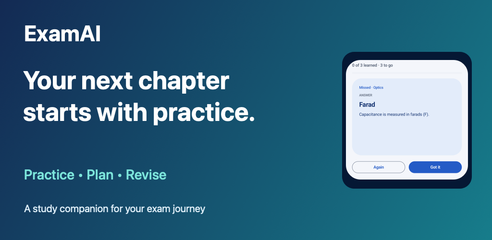
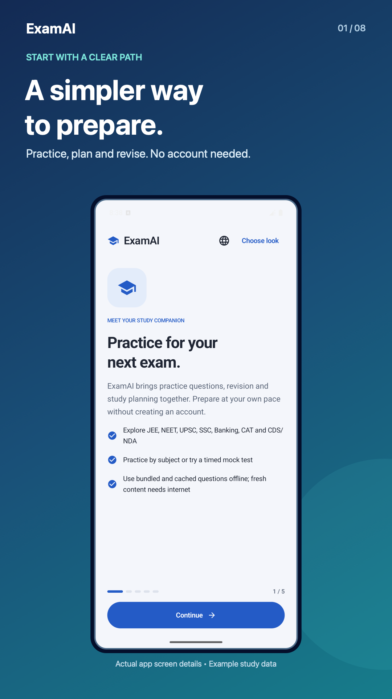
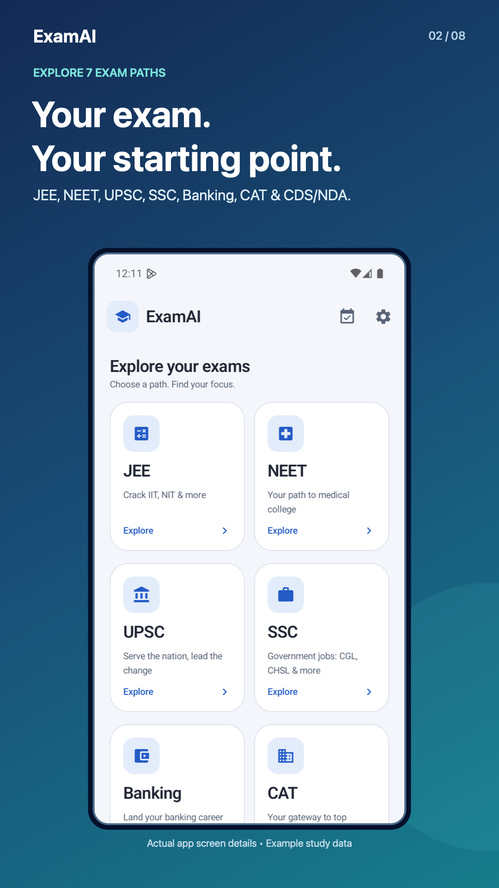
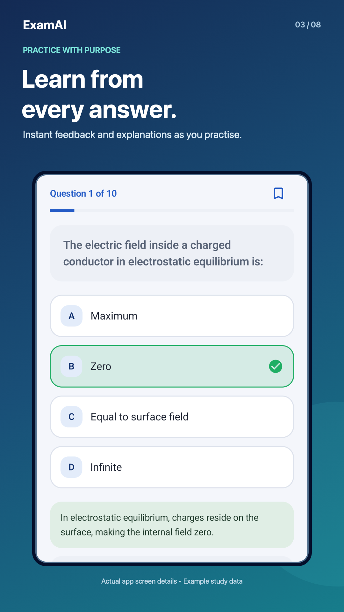
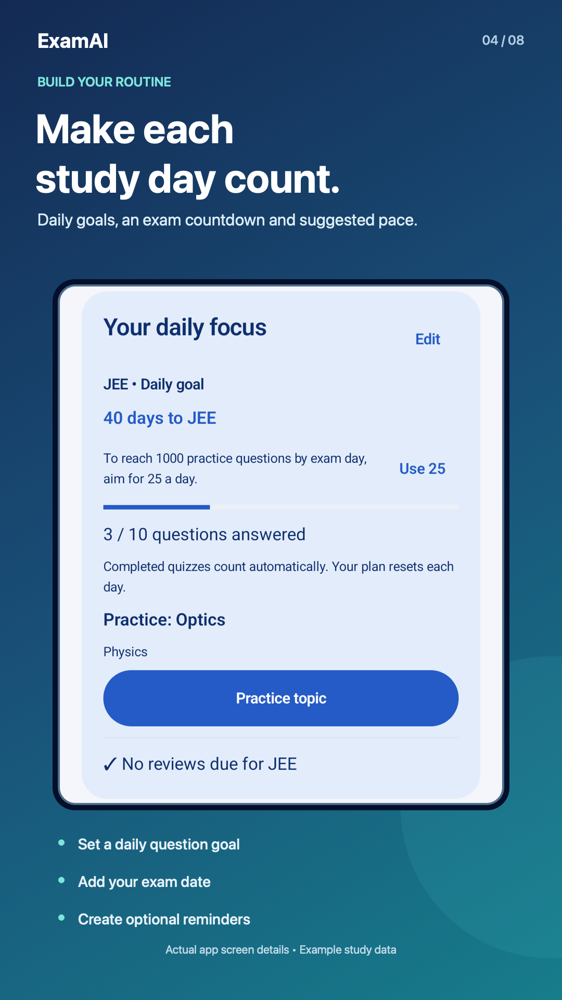
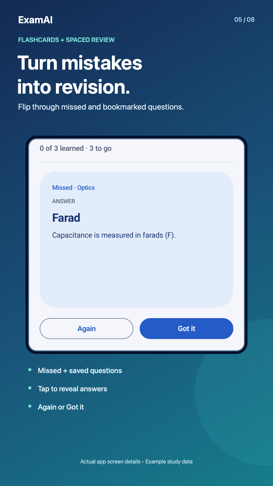
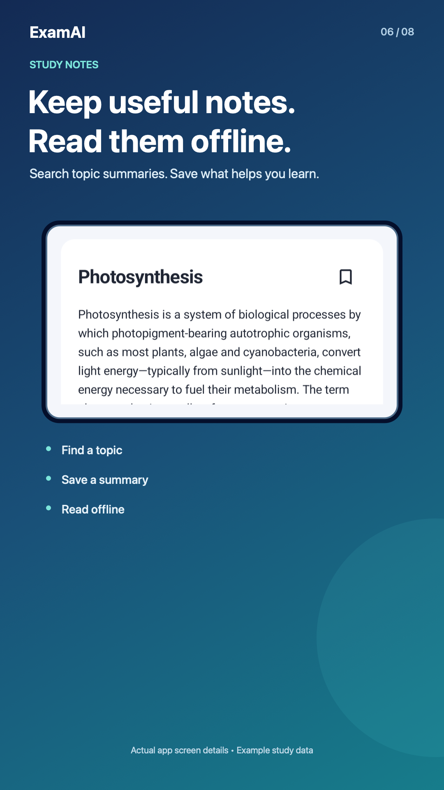
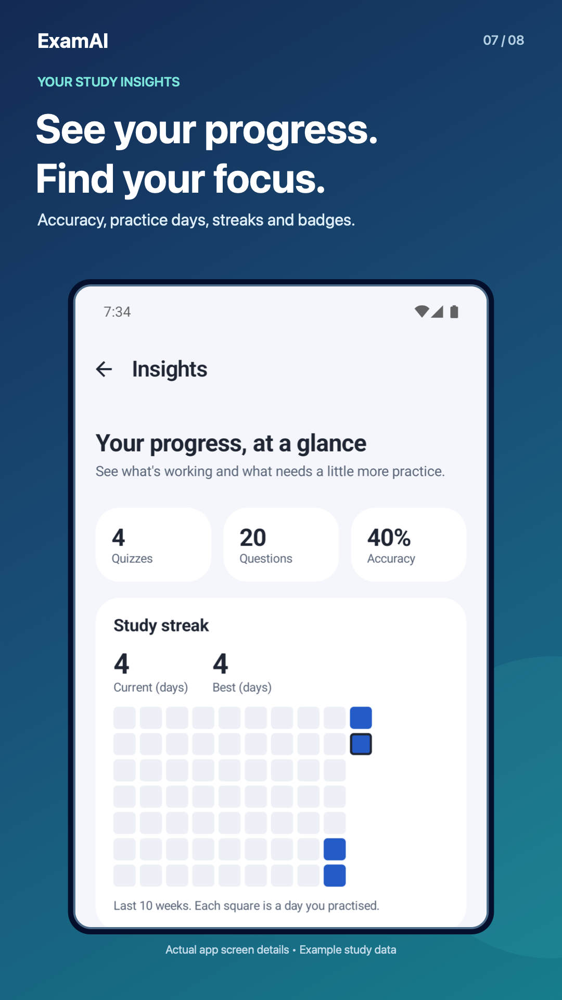
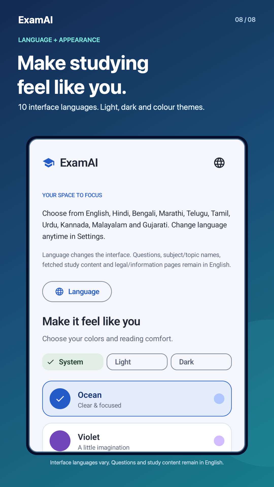

# ExamAI: JEE NEET UPSC CAT Prep




Build a study routine that fits your day. ExamAI brings practice questions, timed mock tests, flashcards, notes and progress tracking into one easy-to-use Android app for students preparing for Indian competitive exams. Start studying without creating an account.

**[Get ExamAI on Google Play](https://play.google.com/store/apps/details?id=com.ai.studyassistant)** · [Learn on Brynflow](https://brynflow.com/exams) · [Privacy Policy](PRIVACY_POLICY.md) · [Contact support](mailto:contact@brynflow.com)

The app is free to use and contains banner, interstitial and optional rewarded ads. This repository contains version **1.2.4 (13)**; availability of updates on Google Play depends on review and rollout.

## See what you can do

These eight store images show the refreshed interface and study tools. Promotional images contain no ads; progress screens use example study data.

| Start studying | Choose your exam |
| --- | --- |
|  |  |
| **Practise questions** | **Plan your day** |
|  |  |
| **Revise with flashcards** | **Save useful notes** |
|  |  |
| **Understand your progress** | **Choose your language** |
|  |  |

[Browse the image gallery source](store-assets/preview.html) · [Store descriptions and image details](store-assets/README.md)

## Study tools

- **Practice and mock tests:** choose an exam and subject, answer questions with feedback and explanations, bookmark questions and resume unfinished attempts.
- **Daily goals and countdown:** set a goal of 5–50 questions, add an optional exam date and see a suggested practice pace. Completed quizzes update your progress.
- **Review and flashcards:** revisit missed questions through spaced review, or flip through missed and bookmarked questions in a revision session.
- **Study notes:** search Wikipedia topic summaries and save notes for offline reading. Two free searches replenish daily; an optional rewarded ad adds two searches. Unused earned searches persist, and failed searches consume no credit.
- **Insights and history:** track accuracy, study days, streaks, badges and topics needing practice. Revisit reports, share score cards and export completed quiz history as CSV.
- **Reminders and widget:** create personal reminders, opt into daily study nudges and add a home-screen widget for your streak and reviews due.
- **Appearance and onboarding:** follow a five-page welcome tour, choose one of five colour themes and use light, dark or system mode.
- **Offline study:** use bundled questions, previously loaded content, saved notes, flashcards and local study records without internet. New online content and note searches require a connection.

## Exams and subjects

| Exam | Subjects |
| --- | --- |
| JEE | Physics, Chemistry, Mathematics |
| NEET | Physics, Chemistry, Biology |
| UPSC | History, Geography, Polity, Economy |
| SSC | General Awareness, Quantitative Aptitude, Reasoning |
| Banking | Quantitative Aptitude, Reasoning, Banking Awareness |
| CAT | Quantitative Ability, Verbal Ability, Data Interpretation & Logical Reasoning |
| CDS/NDA | Mathematics, General Knowledge, English |

Available question counts and mock lengths vary by subject. Topic and difficulty choices do not guarantee strict matching for every question. ExamAI is an independent supplementary practice app, is not affiliated with exam authorities and does not provide official past papers or guarantee exam results.

## Languages

Use the interface in **English, Hindi, Bengali, Marathi, Telugu, Tamil, Urdu, Kannada, Malayalam or Gujarati**. Change the language during onboarding or in Settings; Urdu supports right-to-left layout.

Questions, subject/topic names, fetched study content and legal/information pages remain in English. Translation drafts still need native-speaker review. See [LOCALIZATION.md](LOCALIZATION.md) for scope and maintenance.

## Privacy, ads and reminders

Study records, saved notes, reminders and preferences are stored on the device; Android backups may copy them according to device settings. Online content providers, Google AdMob, Firebase Analytics and Crashlytics process information described in the [Privacy Policy](PRIVACY_POLICY.md). The in-app policy at `app/src/main/assets/privacy_policy.md` must stay identical to the root policy.

Ads are requested when Google's UMP consent SDK permits them. Settings exposes ad privacy choices when required. Optional rewarded ads can provide two extra note searches or a **15-minute break from banners and interstitials**. Quiz completion may show an interstitial, with a three-minute cooldown after fullscreen ads. Debug builds use Google test ad units; release builds use the verified ExamAI inventory.

Daily study nudges require opt-in and target 10 AM and 8 PM in local time. Personal reminders support a title, optional note and a scheduled time. Notification permission is required; Android may delay delivery. Optional Alarms & reminders access supports precise personal reminders. Schedules restore after restart, updates and clock/timezone changes.

## Build and run

Use Android Studio with **JDK 17**, Android SDK **36**, and an Android device or emulator running **API 26+**. Internet is needed to resolve build dependencies and use online app features.

```sh
git clone https://github.com/RaiyanShahid91/ExamAI.git
cd ExamAI
```

Open the project in Android Studio, let Gradle sync, then run the `app` configuration. Alternatively:

```sh
./gradlew assembleDebug
```

Firebase configuration is in `app/google-services.json`; use your own Firebase project when maintaining a fork. Configure your own AdMob app ID and release ad units before publishing a fork. Keep signing credentials and `local.properties` out of version control.

## Technology and project layout

Kotlin, Jetpack Compose, Material 3, MVVM, Coroutines/StateFlow, Room, WorkManager, Retrofit/OkHttp, Firebase Analytics/Crashlytics, Google Mobile Ads and UMP. Online study content uses Open Trivia DB and Wikipedia.

```text
app/src/main/
├── java/com/ai/studyassistant/
│   ├── ads/             # Consent, ad units and reward handling
│   ├── data/            # Models, local storage, APIs and repositories
│   ├── i18n/            # Interface language selection
│   ├── navigation/      # Routes and navigation actions
│   ├── notification/    # Daily and personal reminders
│   ├── ui/              # Compose screens, components, themes and utilities
│   ├── viewmodel/       # Screen state and study logic
│   └── widget/          # Home-screen study widget
├── assets/              # Bundled content and privacy policy
└── res/                 # Translations and Android resources
store-assets/            # Store descriptions, graphics and source captures
```

## Verification and contributing

```sh
./gradlew testReleaseUnitTest lintRelease
```

The latest pre-push release check passed **62 JVM tests** and release lint with warnings. Device tests cover core study flows, onboarding, languages and reminders; detailed results and limitations are in [QA_REPORT.md](QA_REPORT.md).

For contributions, fork the repository, create a feature branch, make your changes and open a pull request. Include relevant validation and screenshots for UI changes.

Built by **Raiyan Shahid** · [Brynflow](https://brynflow.com/exams) · [contact@brynflow.com](mailto:contact@brynflow.com)
